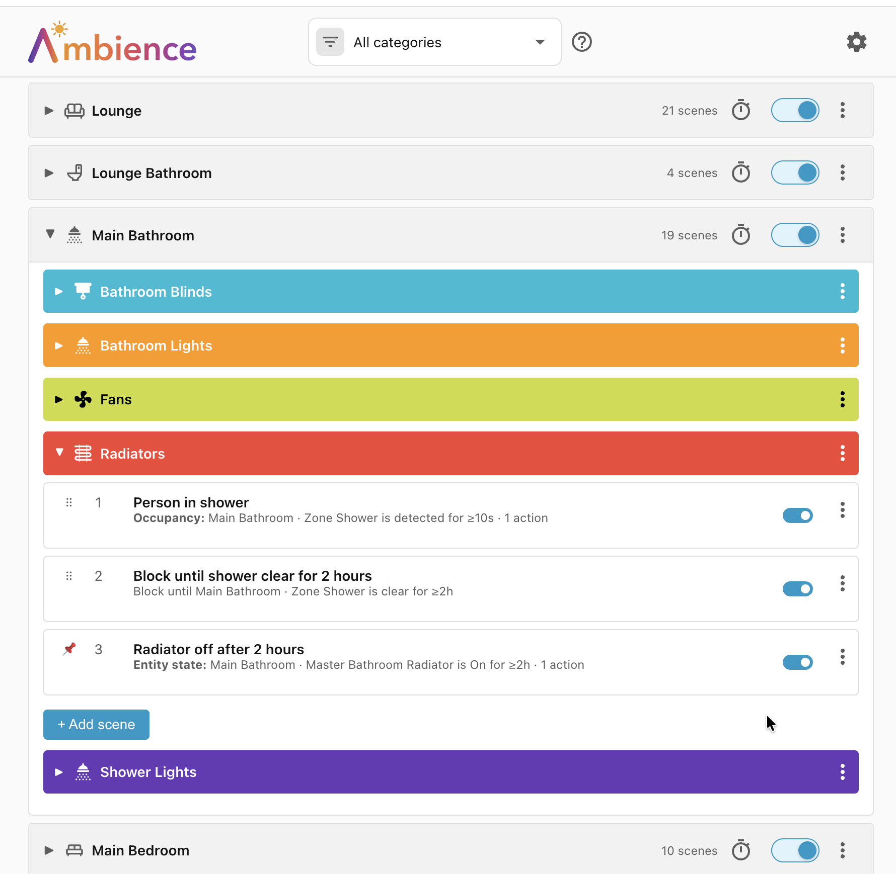

# Ambience

Ambience is a **condition-based scene engine** for Home Assistant. You describe
scenes for a room — _"Room is empty"_, _"Movie time"_ — along with the
conditions under which each scene should apply — _"Projector is turned on"_,
_"Person in room"_, _"Daytime"_, _"Cloudy weather"_. Ambience watches your home
and applies the best-matching scene automatically.

**Full documentation is published at
[clintongormley.github.io/ambience](https://clintongormley.github.io/ambience/).**

## Installation

Requires Home Assistant **2025.2.0** or newer.

### Home Assistant 2026.11 or newer

Ambience is in the **Marketplace**, which comes with Home Assistant, so there is
nothing else to install first.

[Open Ambience in your Home Assistant](https://my.home-assistant.io/redirect/hacs_repository/?owner=clintongormley&repository=ambience&category=integration),
or find it yourself:

1. Go to **Settings → Marketplace**. The first time you open it, Home Assistant
    warns you that community projects are not reviewed by the Home Assistant
    project, and you need to accept that before you can install anything.
1. Search for **Ambience** and open it.
1. Select **Install**, check the version in the dialog, and select **Install**
    again.

Either way, the setup page normally opens when the installation finishes. If it
doesn't, restart Home Assistant, then go to **Settings → Devices & Services →
Add Integration** and search for *Ambience*.

### Home Assistant 2026.10 or older

Ambience is in **HACS**, and the same link above opens it there. To find it
yourself, open **HACS** in the sidebar, search for **Ambience**, and click
**Download**.

Then:

1. Restart Home Assistant.
1. Go to **Settings → Devices & Services → Add Integration** and search for
    *Ambience*.

See the [full documentation](https://clintongormley.github.io/ambience/) for
details.

## For developers

- **[ARCHITECTURE.md](https://github.com/clintongormley/ambience/blob/main/ARCHITECTURE.md)**
    — how Ambience works inside: the engine, scene resolution, WebSocket API,
    and the frontend build pipeline.
- **[CONTRIBUTING.md](https://github.com/clintongormley/ambience/blob/main/CONTRIBUTING.md)**
    — dev environment setup, quality gates, and how to run tests.
