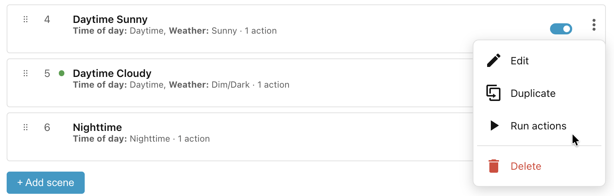

# How actions run

Ambience re-evaluates your scenes continuously. Whenever the winning scene
changes — because a condition changes state, the time crosses a boundary, or
something else shifts — it applies the new winner's actions immediately.

If you want to test a scene's actions without waiting for its conditions to
match, use the **Run actions** option in the scene's action menu. This runs that
scene's actions once, independently of the normal evaluation cycle. If the
engine is applying the same scope and category at that moment, the manual run
waits for the engine to send its actions rather than interleaving with it.

## Action execution model

When a scene wins, Ambience sends all of its actions at once rather than one
after another, so a scene that turns on three lights and closes a blind changes
all four together. Because the actions run side by side, they can finish in any
order. If two actions in the same scene target the same entity, whichever
arrives last wins, so give each entity one action per scene.

Ambience waits up to half a second for the actions to finish, then moves on and
lets any that are still running carry on in the background. Ordinary commands,
like turning a light on or setting its brightness, finish well inside that half
second. A long-running action, like a
[Fado](https://github.com/clintongormley/ha-fado) fade that takes ten minutes,
does not hold anything up.

That matters when conditions change while a scene is still being applied. Say
the evening scene starts a ten-second fade down, and two seconds later someone
walks in and the occupied scene wins. Ambience applies one scene per scope and
category at a time, so the occupied scene waits for the evening scene's actions
to be sent. It waits half a second at most, not for the fade to finish, and then
starts its own fade from wherever the lights have got to. The half-second wait
keeps ordinary commands in order: the evening scene's command reaches a light
before the occupied scene's command does.

One failing action does not stop the others. Ambience skips a malformed action,
or one whose action is no longer exposed, with a warning in the log. If an
action fails while running, even after Ambience has moved on, the log shows
`ambience: action raised:` followed by the error.

______________________________________________________________________

Next: [Settings reference](../settings-reference.md).
